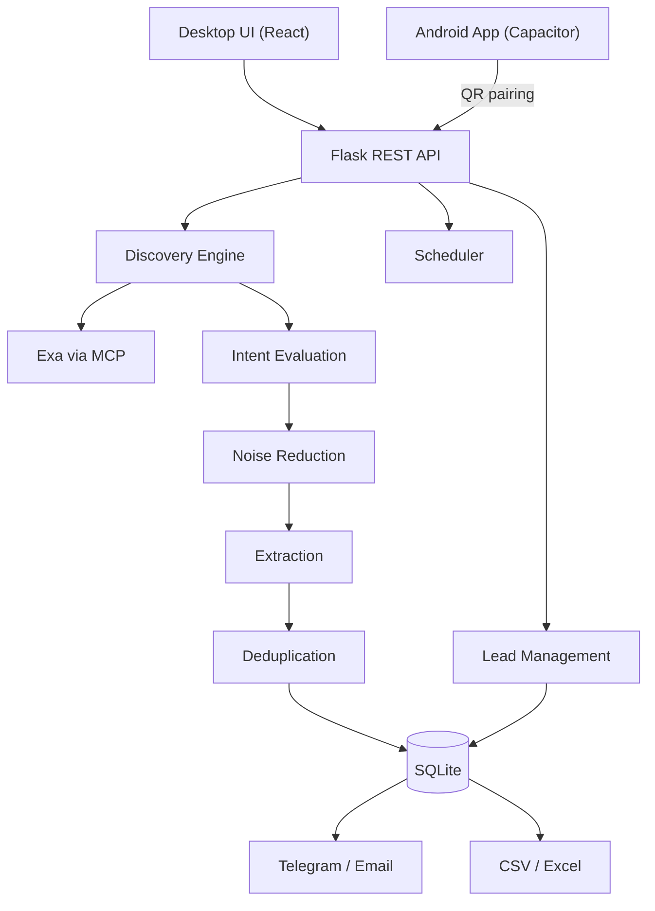

<div align="center">

# LeadPulse

**Find people who are already looking for your services.**

Social lead discovery for freelancers, agencies, and B2B service providers.


</div>

---

## Overview

Potential customers regularly describe what they need in public posts and communities. Finding those posts manually means searching several platforms, filtering noise, and keeping track of prospects.

LeadPulse automates that workflow. It searches public sources for service inquiries, scores them with a deterministic rule engine, extracts structured lead data, removes duplicates, and stores everything in a lead database you can review from desktop or Android.

## Features

- **Multi-source discovery** across LinkedIn, X (Twitter), Reddit, and open web discussions, powered by Exa through MCP.
- **Deterministic intent detection.** Classification uses explicit signals, keywords, patterns, and rejection rules rather than LLM judgment, so results are predictable and easy to inspect.
- **Noise filtering.** Job seekers, resumes, portfolio promotions, and internship requests are rejected.
- **Structured extraction.** Company, contact, role, service category, location (when available), source platform, and original URL. Missing fields are left empty, never guessed.
- **Deduplication** by normalized URL and platform identifier.
- **Lead management.** Search, filter, review, and update status (new, contacted, qualified), with source and service-demand breakdowns.
- **Custom queries.** Define your own search queries by platform, keyword, and service category.
- **Scheduler.** Automated discovery every 15 minutes, 30 minutes, 1, 6, 12, or 24 hours (APScheduler).
- **Notifications** via Telegram bot and SMTP email reports.
- **Export** to CSV and multi-sheet Excel (.xlsx).
- **Android app with QR pairing.** Connect the mobile app to the desktop backend over local Wi-Fi by scanning a code.
- **Credential protection.** Telegram tokens and SMTP credentials are encrypted with Windows DPAPI.

### Target categories

Digital marketing, growth marketing, SEO, social media marketing and management, performance marketing, Google and Meta Ads, web development, full-stack engineering, content marketing, copywriting, lead generation, cold email outreach, brand identity, and graphic design. Custom categories can be added.

## Architecture



| Layer | Stack |
|---|---|
| Backend | Python, Flask, SQLAlchemy, SQLite |
| Frontend | React, Vite |
| Mobile | Capacitor, Android |
| Scheduling | APScheduler |
| Search | Exa (MCP) |
| Notifications | Telegram Bot API, SMTP |
| Export | CSV, OpenPyXL |
| Testing | Pytest |

## Download

Version 1.0.2 is available as repository-local artifacts:

| Platform | Requirements | File |
|---|---|---|
| Windows | Windows 10/11, 64-bit | `installer_dist/lead finder v2.exe` |
| Android | Android 8.0+ | `android_dist/lead-finder-v2.apk` |

## Getting Started

**Requirements:** Python 3.10+, Node.js 18+. Building the APK additionally needs JDK 21 and the Android SDK.

### Clone

```bash
git clone https://github.com/sairam-s0/social-media-lead-finder.git
cd social-media-lead-finder
```

### Backend

```bash
cd backend
python -m venv venv
.\venv\Scripts\Activate.ps1
pip install -r requirements.txt
python app.py
```

The API runs at `http://127.0.0.1:5050`. The database is stored at `%APPDATA%\SocialLeadFinder\data\leads.db`.

### Frontend

In a second terminal:

```bash
cd frontend
npm install
npm run dev
```

Open `http://localhost:5173`.

> **Android pairing:** the backend must listen on a LAN interface, and the phone must connect to the desktop's local IP address. `127.0.0.1` will not work from the device.

## Configuration

Settings can be managed in the app. An optional `backend/.env` file is also supported:

```env
PORT=5050
HOST=127.0.0.1

SEARCH_INTERVAL_MINUTES=60
SCHEDULER_ENABLED=true

TELEGRAM_BOT_TOKEN=
TELEGRAM_CHAT_ID=
TELEGRAM_ENABLED=false

COMPANY_NAME=LeadPulse
COMPANY_TAGLINE=Social Lead Discovery Engine
COMPANY_LOGO=LP
PRIMARY_COLOR=#5e6ad2
```

This is an example; variable names should match the backend implementation. MCP is configured separately through your existing MCP setup. Do not commit `.env` files or tokens.

## Testing

```bash
python -m pytest backend/tests
```

The real-search check requires the search integration and MCP environment:

```bash
python backend/tests/test_real_search.py
```

## Building from Source

**Windows installer** (PyInstaller and Inno Setup), from the project root:

```bash
python build_production.py
```

Output: `installer_dist/lead finder v2.exe`

**Android APK:**

```bash
cd frontend
npm install
npm run build
npx cap sync android
cd android
```

```powershell
$env:JAVA_HOME = "C:\Path\To\jdk-21"
.\gradlew.bat assembleDebug
```

Output: `android_dist/lead-finder-v2.apk`

## Project Structure

```text
.
├── backend/
│   ├── api/           REST routes
│   ├── database/      SQLAlchemy models
│   ├── services/      Exa connector, discovery, intent evaluation,
│   │                  parser, deduplication, notifications, scheduler
│   └── tests/
├── frontend/
│   ├── src/           components, pages, services
│   └── android/       Capacitor project
├── installer_dist/
├── android_dist/
├── build_production.py
├── features.md
└── DESIGN.md
```

## Roadmap

- [ ] Intent scoring and ranking
- [ ] Search precision and recall benchmarking
- [ ] Cross-source duplicate detection
- [ ] Lead enrichment
- [ ] Configurable discovery strategies
- [ ] Analytics and conversion tracking
- [ ] More notification and integration options

## Responsible Use

LeadPulse is intended for discovering publicly available service inquiries. You are responsible for complying with each platform's terms of service and applicable privacy laws. Do not use it for spam, harassment, unauthorized access, or misuse of personal information.

## License

MIT. See [LICENSE](LICENSE).
